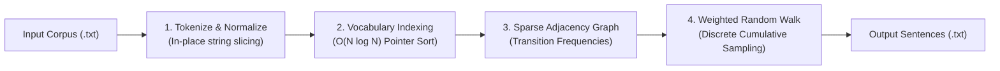

# marsengen

[](https://en.wikipedia.org/wiki/C99)
[](https://cmake.org/)
[](LICENSE)

A high-performance C99 Markov chain sentence generator that extracts n-gram word transitions from text corpora and generates natural-sounding pseudo-random sentences via weighted random walks.

Designed with an emphasis on algorithmic efficiency, zero-copy memory layouts, and compact graph representation without third-party dependencies.

---

## Architecture Overview



### Pipeline Stages

1. **Tokenization & Normalization (`tokenizer.c`)**:
   Reads the corpus into a single contiguous buffer and normalizes characters in-place (case folding, non-alpha delimiter coalescing). Produces lightweight `token_t { char *ptr; int len; }` slices without heap allocations per word.
2. **Vocabulary Deduplication & Canonicalization (`tokenizer.c`)**:
   Sorts an array of token pointers using `qsort` in $O(N \log N)$ time. Repeated occurrences are canonicalized to point to the first unique token instance, constructing a deduplicated vocabulary list.
3. **Adjacency Transition Graph (`markov.c`)**:
   Constructs bigram pairs $(w_i, w_{i+1})$ and builds a sparse adjacency list (`word_transitions_t`). Word pointer lookups use an $O(\log U)$ binary search over sorted memory addresses, tracking discrete frequency counts.
4. **Weighted Random Walk Synthesis (`markov.c`)**:
   Picks a random initial word and traverses transitions using cumulative frequency sampling ($O(k)$ per step, where $k$ is the out-degree) until reaching the maximum word threshold or a terminal state.

---

## Usage

### Building

Ensure CMake 3.28+ and a C99 compiler (GCC, Clang, or MSVC) are installed:

```bash
cmake -B build
cmake --build build
```

To build with `gprof` profiling instrumentation enabled:

```bash
cmake -B build -DENABLE_PROFILING=ON
cmake --build build
```

### Running

```bash
# Run with default settings (corpus: input.txt, output: output.txt)
./build/marsengen

# Specify corpus and custom output destinations
./build/marsengen -c docs/examples/inputs/iliad.txt -o output.txt

# Configure sentence count, maximum words, and reproducible random seed
./build/marsengen -c docs/examples/inputs/iliad.txt -n 3 -w 25 -s 42 -v
```

### CLI Options

| Flag | Long Option | Parameter | Description | Default |
| :--- | :--- | :--- | :--- | :--- |
| `-c`, `-i` | `--corpus`, `--input` | `<path>` | Input text corpus file | `input.txt` |
| `-o`, `-l` | `--output`, `--log` | `<path>` | Output destination file | `output.txt` |
| `-n` | `--sentences` | `<count>` | Number of sentences to generate | `10` |
| `-w` | `--words` | `<count>` | Maximum word limit per sentence | `50` |
| `-s` | `--seed` | `<number>` | Seed for pseudo-random generator | `time(NULL)` |
| `-v` | `--verbose` | _none_ | Print processing stats to stdout | Disabled |
| `-h` | `--help` | _none_ | Display usage instructions and exit | - |

---

## Example Output

Generated from Homer's *The Iliad* (`docs/examples/inputs/iliad.txt`, ~198K tokens, 12.5K unique vocabulary):

```text
Sentence: "the god who flies from fair strand obedient flame then gather or at the mountain s name though all the main"
Sentence: "he spoke imperial dame althaea to man can the latter being the challenge hector still close to her lingering troops"
Sentence: "great ulysses rose and shades of ears the hand shall perceive the spinal marrow flies at our tents"
```

---

## Profiling & Benchmarks

Profiled with `gprof` on *The Iliad* corpus (1.16 MB unformatted text, 198,025 tokens):

| Function | % Time | Self Time (s) | Cumulative (s) | Calls | Algorithmic Role |
| :--- | :---: | :---: | :---: | :---: | :--- |
| `build_adjacency_list` | 46.15% | 0.06 | 0.06 | 1 | Sparse graph construction & transition tallying |
| `find_token_idx` | 23.08% | 0.03 | 0.09 | 396,048 | $O(\log U)$ binary search on pointer-address map |
| `generate_sentences` | 7.69% | 0.01 | 0.10 | 1 | Weighted random walk sentence synthesis |
| `generate_bigrams_from_tokens`| 7.69% | 0.01 | 0.11 | 1 | Sequential pairing of token pointers ($O(N)$) |
| `tokenize_input_text` | 7.69% | 0.01 | 0.12 | 1 | Linear scanning and slice generation ($O(L)$) |
| `token_ptr_cmp` | 7.69% | 0.01 | 0.13 | - | String-slice comparator for $O(N \log N)$ sorting |

---

## Algorithmic Optimizations

- **$O(N \log N)$ Vocabulary Deduplication vs $O(N \cdot U)$ Naive Lookup**:
  Instead of linearly scanning accumulated unique words for every token ($N \times U$ operations $\approx 2.4 \times 10^9$ string checks), an array of token pointers is sorted with `qsort` in $O(N \log N)$. Identical words become contiguous, reducing deduplication to a single pass.
- **Pointer Address Canonicalization & Binary Search**:
  After vocabulary extraction, all duplicated tokens have their memory address updated to point to the single canonical unique token. Finding tokens during adjacency construction uses an $O(\log U)$ binary search over sorted pointers rather than repeated `strcmp` calls over string buffers.
- **Sparse Adjacency List vs Dense Matrix**:
  With $U = 12,520$ unique words, a standard transition matrix would require $12,520 \times 12,520 \times 4\text{ bytes} \approx 627\text{ MB}$ of memory (most entries being zero). Using dynamic arrays of `transition_t` per word maintains an $O(V + E)$ footprint under a few megabytes while optimizing cache locality during random walks.
- **Zero-Copy In-Place Buffer Slicing**:
  The corpus is loaded once into a contiguous character buffer and normalized in-place. All tokens are represented as string slices (`token_t { char *ptr; int len; }`), eliminating hundreds of thousands of heap allocations and avoiding heap fragmentation.
